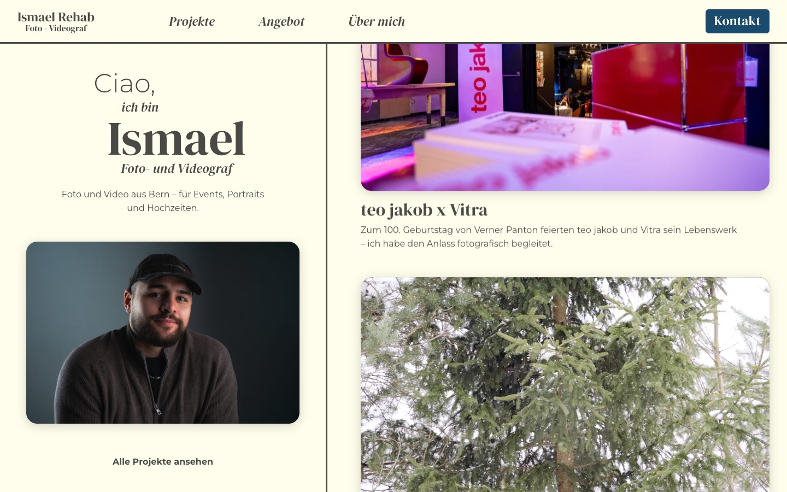
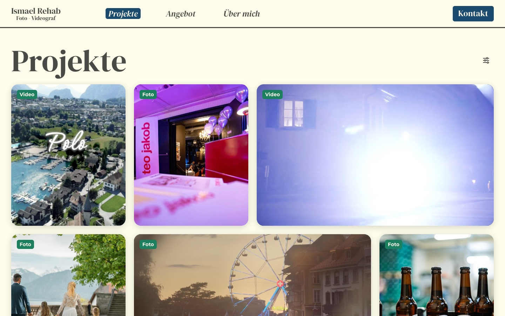
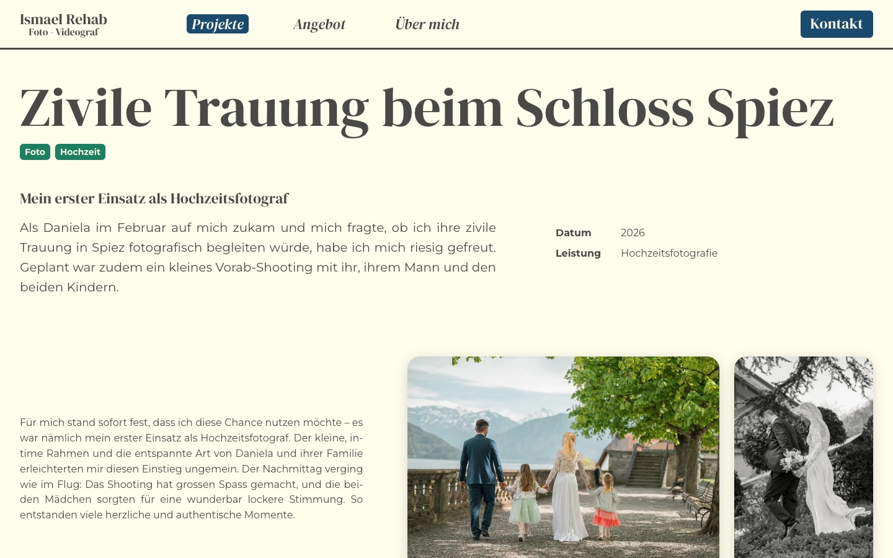
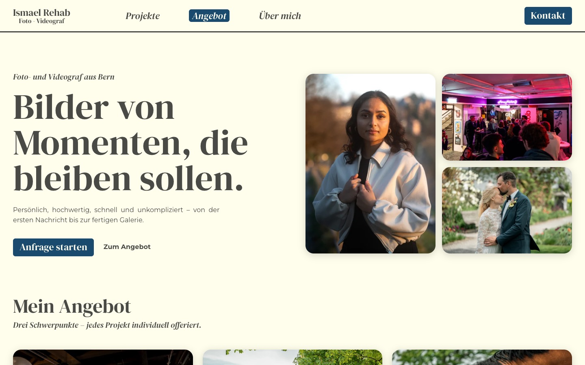
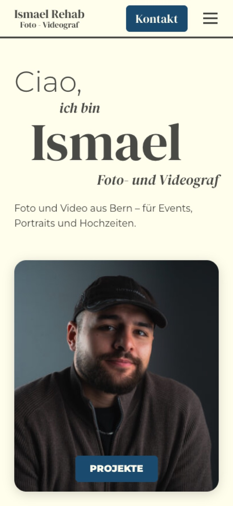
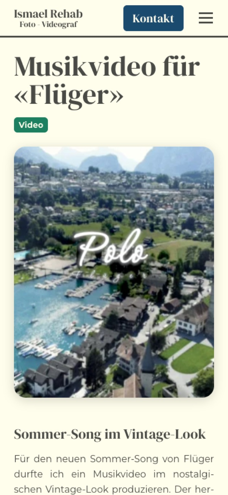
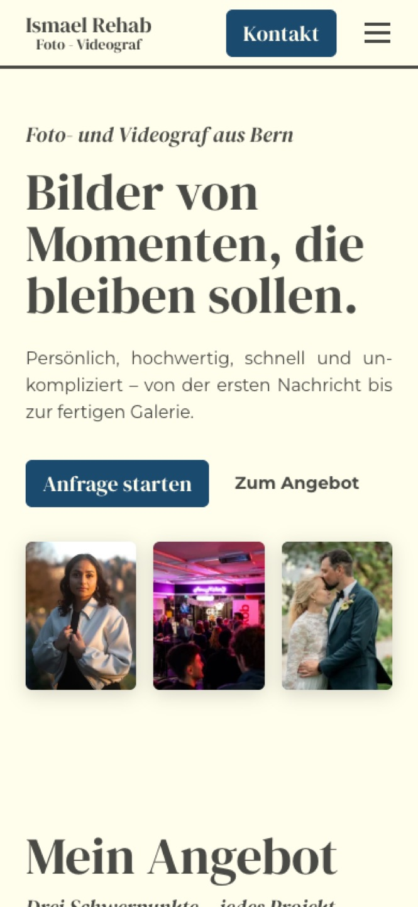

# Ismael Rehab – Portfolio-Theme

Eigenes WordPress-Theme für mein Foto- und Video-Portfolio, entstanden im Modul Interaktive Medien 5 (FHGR, HS26).

**Live:** [ismael-rehab.ch](https://ismael-rehab.ch)



## Projektidee

Ich bin Foto- und Videograf in Bern und begleite Events, Portraits und Hochzeiten. Die Website soll zwei Dinge leisten:

1. **Meine Arbeit zeigen**: Projekte stehen im Zentrum, mit grossen Bildern, Videos und kurzen Geschichten dazu.
2. **Den Weg zur Anfrage kurz machen**: Kontakt ist auf jeder Seite einen Klick entfernt, das Angebot zeigt Ablauf und Leistungen transparent.

Zielgruppe sind Privatpersonen (Hochzeiten, Portraits) und Firmen (Events) im Raum Bern. Gestaltet ist die Seite nach eigenen Figma-Entwürfen mit vier Farben, zwei Schriften und einem 8-px-Raster.

## Screenshots

| Projekte | Projektseite | Angebot |
|---|---|---|
|  |  |  |

| Startseite Handy | Projekt Handy | Angebot Handy |
|---|---|---|
|  |  |  |

## Funktionen

**Für Besucherinnen und Besucher**
- Startseite mit getipptem Titel beim ersten Besuch und endlos gleitendem Projekt-Band
- Projekte-Übersicht mit zufälligem, gewichtetem Raster und Filter nach Kategorie (einblendbar)
- Projektseiten mit Stammdaten, YouTube-Videos, Reels, Bildergalerien in Bildreihen ohne Zuschnitt und Grossansicht zum Durchklicken
- «Andere Projekte» als Endlos-Band am Ende jeder Projektseite
- Angebotsseite mit Karten (auf dem Handy als zentriertes Karussell), Ablauf in Phasen und vorausgewähltem Anlass im Formular
- Kontaktformular als Overlay mit Validierung pro Feld, Rückmeldung und E-Mail-Versand
- Weiche Seitenübergänge, Scroll-Animationen, eigener Mauszeiger und saisonaler Schnee, alles aus bei «Bewegung reduzieren»

**Für mich als Redakteur (WordPress-Backend)**
- Seiten und Projekte werden aus 20 Bausteinen zusammengesetzt, gruppiert nach «Inhalt», «Seite» und «Angebot»
- Bausteine können eine Breite bekommen (ganz, zwei Drittel, Hälfte, Drittel) und stehen dann nebeneinander
- Globale Einstellungen für Kontakt, Social Media, Formular, SEO und Saison
- Bilder werden beim Hochladen automatisch als WebP in passenden Grössen gespeichert

## Technologien

| Technologie | Einsatz |
|---|---|
| **WordPress, eigenes Theme** | Klassisches Theme ohne Gutenberg, eigene Templates, Custom Post Type `project`, Taxonomie `project_category` |
| **PHP / Datenbank** | Felder mit [Carbon Fields](https://carbonfields.net/) (Baustein-System, Theme-Optionen), Getter-Funktionen, AJAX-Kontaktformular mit `wp_mail()` |
| **Eigener Pagebuilder** | Komplexes Feld `modules` mit 20 Bausteinen, Rendering in `render_modules()` |
| **API** | Eigene REST-API (`/wp-json/ismael/v1/…`) mit Rechteprüfung zum Lesen und Pflegen von Inhalten per Anwendungspasswort; YouTube-Einbettung |
| **HTML / CSS / JavaScript** | Natives CSS-Nesting, Container- und Media-Queries, ES-Module ohne Build-Schritt |
| **Über den Unterricht hinaus** | View Transitions API (Seitenwechsel), Scroll-Driven Animations (Parallax), Canvas (Schnee), IntersectionObserver (Reveals, Videos), WordPress Application Passwords, JSON-LD für Suchmaschinen |

## Architektur

```
├── functions.php            lädt alle Teile aus backend/
├── header.php / footer.php  HTML-Gerüst, lädt CSS und JS mit Cache-Busting
├── index.php                404-Seite
├── page.php                 Seiten
├── single-project.php       Projektseiten
├── backend/
│   ├── init/                Admin aufräumen, Bildgrössen, WebP
│   ├── helpers/             Medien, Menüs, YouTube-ID
│   ├── cpt/ · tax/          Projekte und Kategorien
│   ├── carbonfields/        Felder: Bausteine, Projekte, Globales, SEO
│   ├── getter/              Daten für die Views (Projekte, Globales)
│   ├── contact/             AJAX-Handler fürs Formular
│   ├── seo/                 Titel, Beschreibung, Open Graph, JSON-LD
│   └── api/                 eigene REST-API
├── frontend/
│   ├── views/               layout · pages · modules · teaser · partials
│   ├── styles/main.css      Design-Tokens und alle Komponenten
│   ├── scripts/main.js      Interaktionen und Bewegung
│   └── assets/              Schriften (selbst gehostet), Favicon
└── docs/screenshots/        Bilder für dieses README
```

**Ablauf beim Aufruf einer Seite**

1. Das Template (z. B. `page.php`) lädt Header, die passende View aus `frontend/views/pages/` und den Footer.
2. Die View ruft `render_modules()` auf. Die Funktion holt die Bausteine der Seite, bereitet ihre Daten auf (z. B. Bild-IDs zu Bilddaten, Galerie in Bildreihen) und lädt pro Baustein `frontend/views/modules/<baustein>.php`.
3. Schmale Bausteine werden dabei in Reihen eines 12-Spalten-Rasters gruppiert.
4. Die Views geben nur aus, Daten holen sie nie selbst. So bleibt die Logik in `backend/`.

**Einen Baustein ergänzen** braucht drei Schritte: Felder in `backend/carbonfields/_modules.php`, optional Datenaufbereitung in `render_modules()`, View in `frontend/views/modules/`. Die Anleitungen in [`manuals/`](manuals/) beschreiben das und weitere Standard-Erweiterungen.

## Setup

1. WordPress (ab 6.x) mit PHP 8 installieren.
2. Plugin **Carbon Fields** installieren und aktivieren (wird vom Theme vorausgesetzt).
3. Diesen Ordner nach `wp-content/themes/` kopieren und das Theme aktivieren.
4. Unter *Einstellungen → Permalinks* einmal speichern (für `/projekt/…`).
5. Seiten anlegen: Startseite (Baustein «Startseite»), Projekte («Projekte-Übersicht»), Angebot, Über mich, Impressum, Datenschutz, AGB. Die Startseite unter *Einstellungen → Lesen* als statische Startseite wählen.
6. Menüs `main` und `legals` unter *Design → Menüs* zuweisen.
7. Unter *Globales* Kontakt, Formular-Empfänger und SEO-Angaben eintragen.

Für den E-Mail-Versand nutzt das Formular `wp_mail()`. Je nach Hosting braucht es dafür ein SMTP-Plugin.

## Qualität

- **Barrierefreiheit:** Sprunglink zum Inhalt, sichtbarer Tastatur-Fokus, Beschreibungen für alle Bilder, Klickflächen ab 44 px, Status-Meldungen für Screenreader, alle Bewegungen respektieren `prefers-reduced-motion`.
- **Performance:** Bilder als WebP mit `srcset`, Lazy Loading ab dem vierten Bild, Titelvideos laden erst, wenn sie sichtbar sind. Gemessen (Nov. 2026): Largest Contentful Paint 0,1–1,4 s, Layout-Verschiebung (CLS) 0.
- **Sicherheit:** Formular mit Nonce und Honeypot, REST-API nur für Administratoren, keine Zugangsdaten im Repository (`.vscode/` mit den FTP-Einstellungen ist in `.gitignore`).

## Entwicklung

Ausgangspunkt war das «Portfolio Starter Theme» aus dem IM5-Unterricht (Ordnerstruktur, Getter-Prinzip, Anleitungen in `manuals/`). Darauf aufbauend sind Gestaltung, Baustein-System, alle Views, Interaktionen und die REST-API neu entstanden.

Bei der Umsetzung habe ich Claude (Anthropic) als Programmier-Assistenz eingesetzt: zum Umsetzen meiner Entwürfe und Feedback-Runden, für Tests und zum Bereinigen des Codes. Konzept, Gestaltung, Inhalte und alle Entscheidungen stammen von mir. Die Datei [`CLAUDE.md`](CLAUDE.md) beschreibt den Aufbau des Themes für diese Zusammenarbeit und dient gleichzeitig als technische Dokumentation.

## Credits

- Starter-Theme: FHGR, Interaktive Medien 5 (HS26)
- [Carbon Fields](https://carbonfields.net/) für die Felder im Backend
- Schriften: Montserrat und DM Serif Display (Google Fonts, selbst gehostet)
- Alle Fotos und Videos: Ismael Rehab
